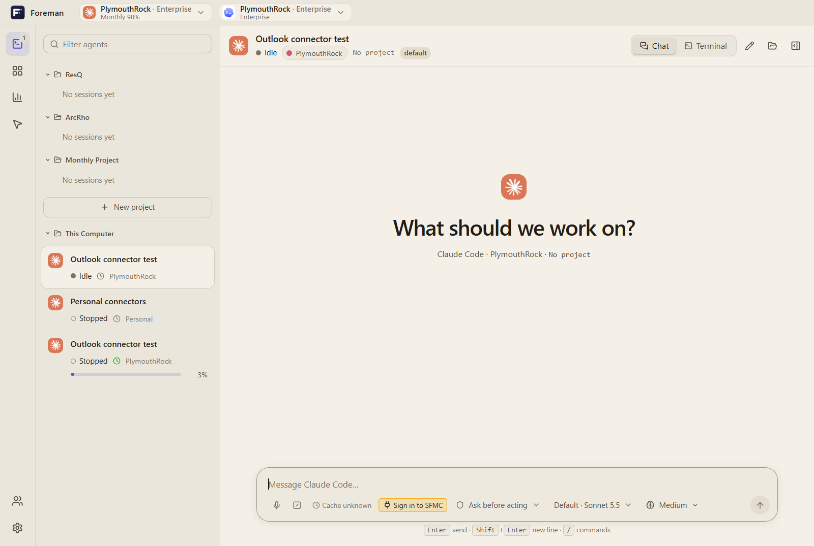
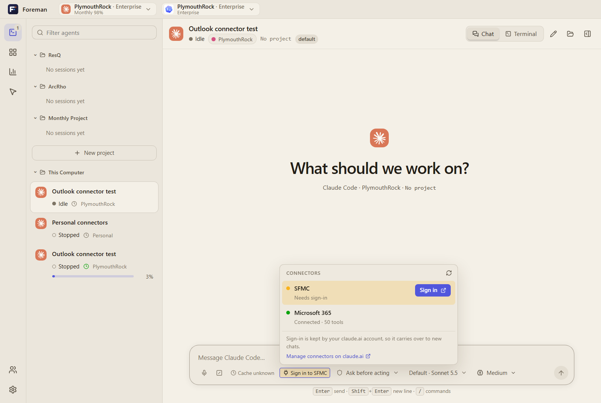
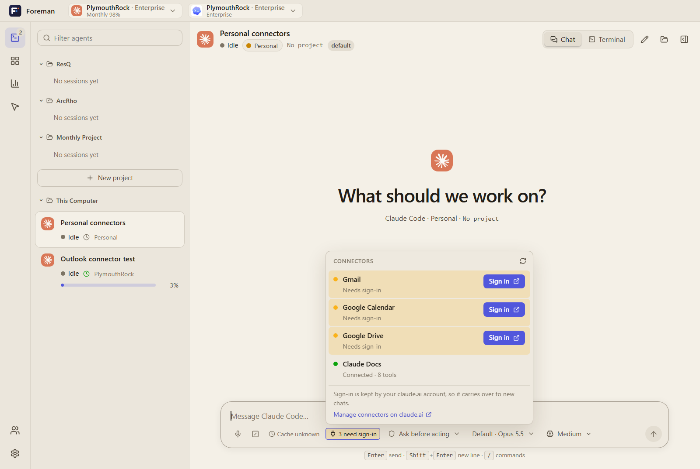
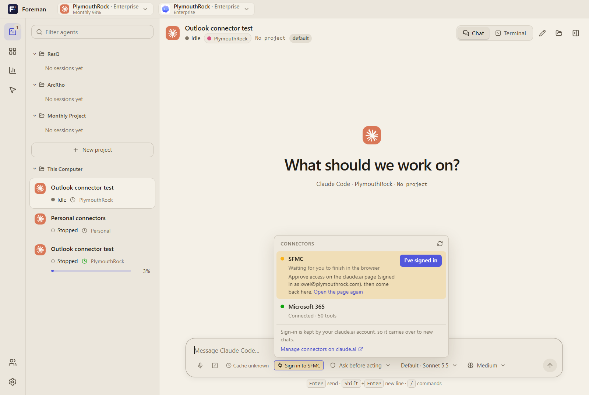
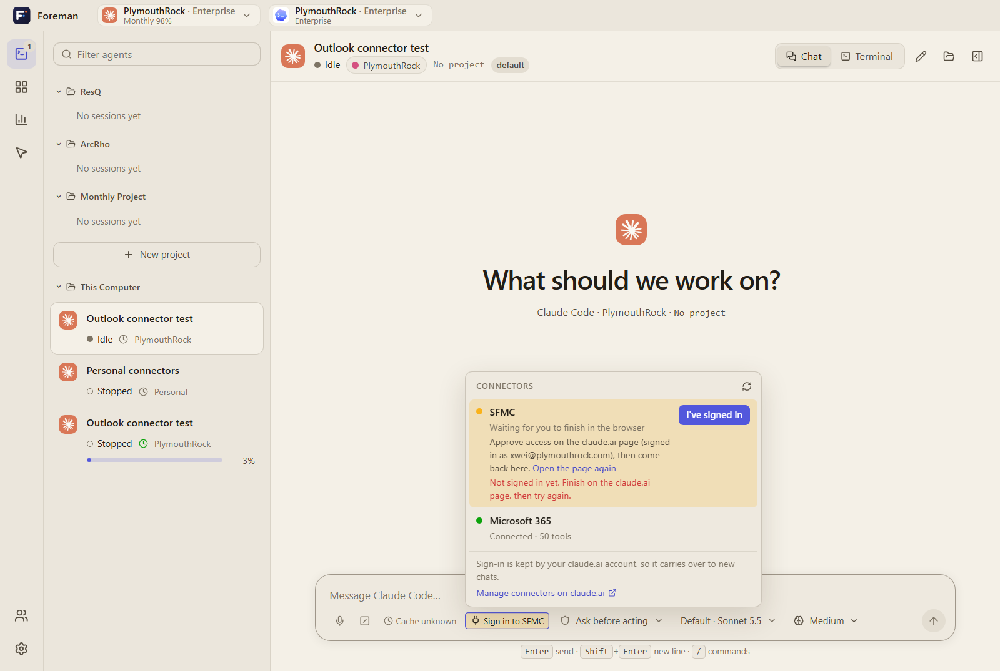
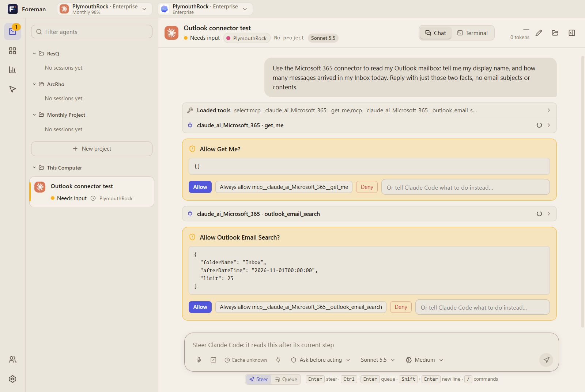
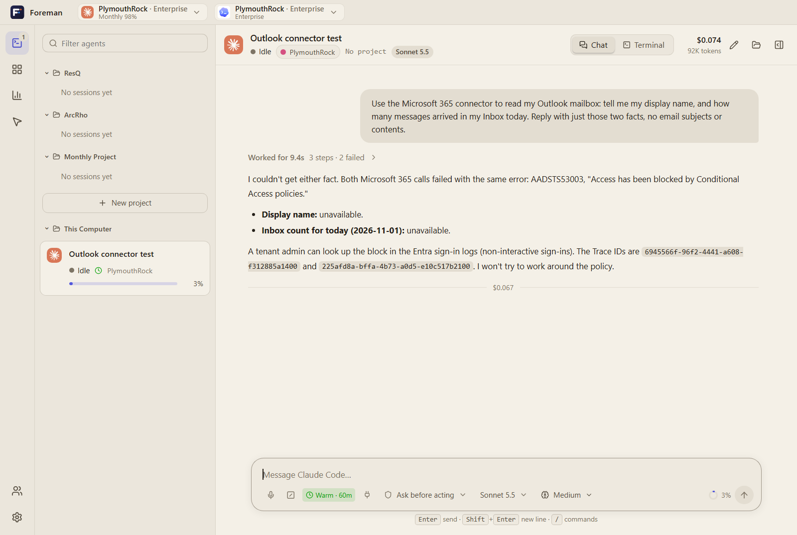
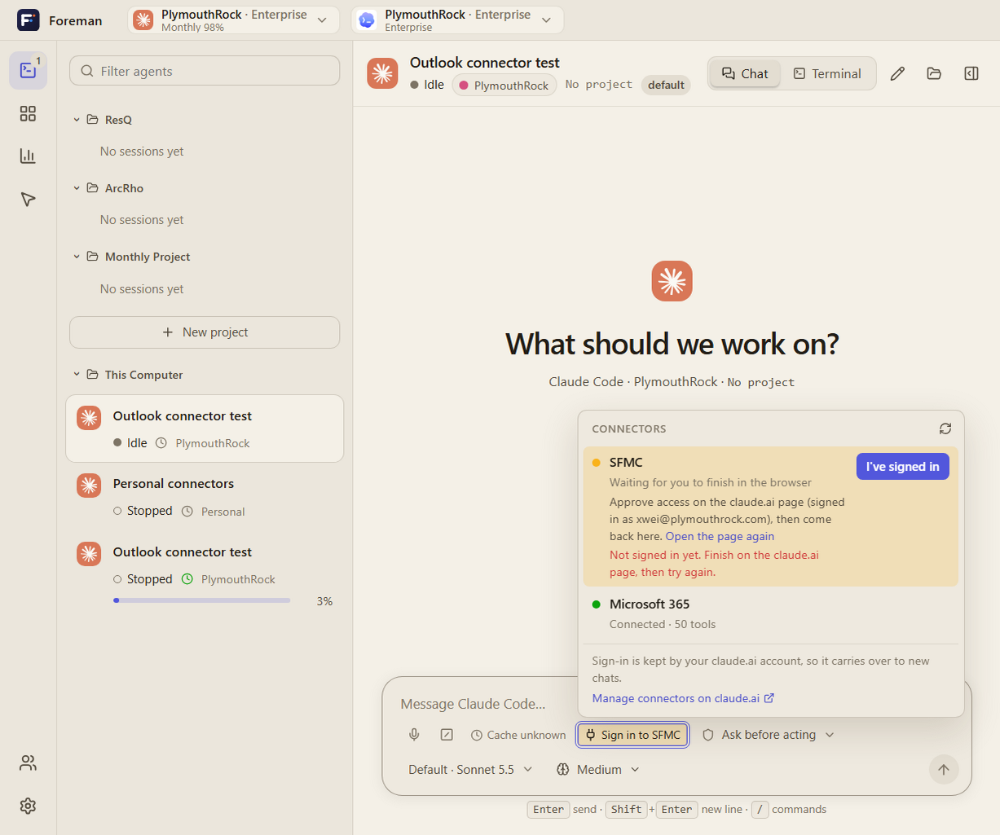

# Email and other connectors in Foreman chats

Claude chats in Foreman can use the **connectors** of your claude.ai account: Microsoft 365 (Outlook mail and calendar, Teams, SharePoint), Gmail, Google Calendar, Google Drive, and others your organization has enabled. With a connector, you can ask Claude to "find the email from Dana about the Q3 numbers" or "what's on my calendar tomorrow?" in an ordinary chat.

This guide covers checking which connectors a chat can use, signing in to one, and what to do when a connector doesn't work.

> Connectors are a Claude Code feature. They appear in **Chat** mode for Claude accounts. Codex chats and Terminal mode don't show the Connectors button.

## Before you start

1. **Add the connector on claude.ai.** Sign in to claude.ai with the same account that you use in Foreman, then open **Settings → Connectors** and add the one you need (for example *Microsoft 365*). Your organization's admin may need to enable it first.
2. **Pick the right account in Foreman.** Connectors belong to one claude.ai account. If you've added Microsoft 365 to your work account, start the chat with your work account in Foreman. The account is chosen in the account picker at the top of the window or in the New agent dialog.

## 1. Check the Connectors button

Start a chat. The **Connectors** button (a plug icon) sits in the bar under the message box, next to the permission setting. A few seconds after the chat starts, it shows one of these:

| What you see | What it means |
| --- | --- |
| Plug icon and a number, e.g. **2** | That many connectors are connected and ready. |
| Amber **Sign in to *name*** | One connector needs you to sign in before Claude can use it. |
| Amber **3 need sign-in** | Several connectors need sign-in. |
| Plug icon only | This account has no connectors. Add them on claude.ai. |

## 2. Open the list

Click the button. The list shows every connector this chat can use:

- **Green dot, "Connected · 50 tools"**: ready to use.
- **Amber row, "Needs sign-in"**, with a **Sign in** button: sign in once (step 3).
- **Red dot, "Failed to connect"**, with a **Retry** button.
- **"local"** marks MCP servers configured on this computer rather than on claude.ai.

The ↻ button at the top checks again. **Manage connectors on claude.ai** opens claude.ai's connector settings in your browser.

A personal account with Gmail, Google Calendar and Google Drive added but not yet authorized looks like this:

## 3. Sign in to a connector

1. Click **Sign in** on the amber row. Foreman opens the connector's authorization page on claude.ai in your default browser.
2. In the browser, make sure you're signed in to claude.ai as the account the row names. Foreman shows the account's email, e.g. *signed in as you@company.com*. Approve access, and complete your provider's sign-in (Microsoft or Google) if asked.
3. Come back to Foreman. It checks again when its window gets focus. You can also click **I've signed in**.

While Foreman waits, the row reads *Waiting for you to finish in the browser*. If you closed the page, click **Open the page again**.

If you click **I've signed in** before finishing, Foreman says so and the row stays open:

Once the connector is connected, the row turns green. The chat shows a note: *Microsoft 365 connected. Its tools are available from your next message.* You don't need to restart the chat.

Sign-in is saved in your claude.ai account. New chats with the same account, in Foreman, Claude Code or claude.ai, are already connected.

## 4. Use it in the chat

Ask in plain language, and name the connector if you want to be sure Claude uses it:

> Use the Microsoft 365 connector to read my Outlook mailbox: how many messages arrived in my Inbox today?

With the default **Ask before acting** permission, Claude asks before each connector action, and the request shows what it will send. Click **Allow** for one action, or **Always allow …** to stop being asked about that tool. Read-only tools search and read. Tools that send mail, delete or move items, or post to Teams change things, so read those requests carefully.

## Troubleshooting

**The agent says the connector "isn't authorized" or "requires authentication."**
Open the Connectors list. If the connector is amber, sign in (step 3), then send your message again.

**The connector isn't in the list.**
It hasn't been added to the claude.ai account this chat uses. Check which account the chat runs as (shown in the chat header), add the connector on claude.ai for that account, and start a new chat.

**"Connected", but every call fails with `AADSTS53003: Access has been blocked by Conditional Access policies`.**
Claude reached Microsoft 365, but your organization's Microsoft Entra Conditional Access policy refused the sign-in. Foreman and Claude can't change this setting; only your IT administrator can. Send them the error and the trace IDs Claude reports; they can look them up under Entra **Sign-in logs → Non-interactive sign-ins**. Mail, calendar and Teams through the connector stay unavailable until they allow it.

**"Failed to connect."**
Click **Retry**. If it keeps failing, open **Manage connectors on claude.ai** and disconnect and reconnect the connector there.

**The chat has ended.**
The Connectors button appears only while the chat is running. Send a message to continue the conversation, and the button comes back.

**Small windows.**
The list fits narrow windows. The bar under the message box wraps onto two lines:

